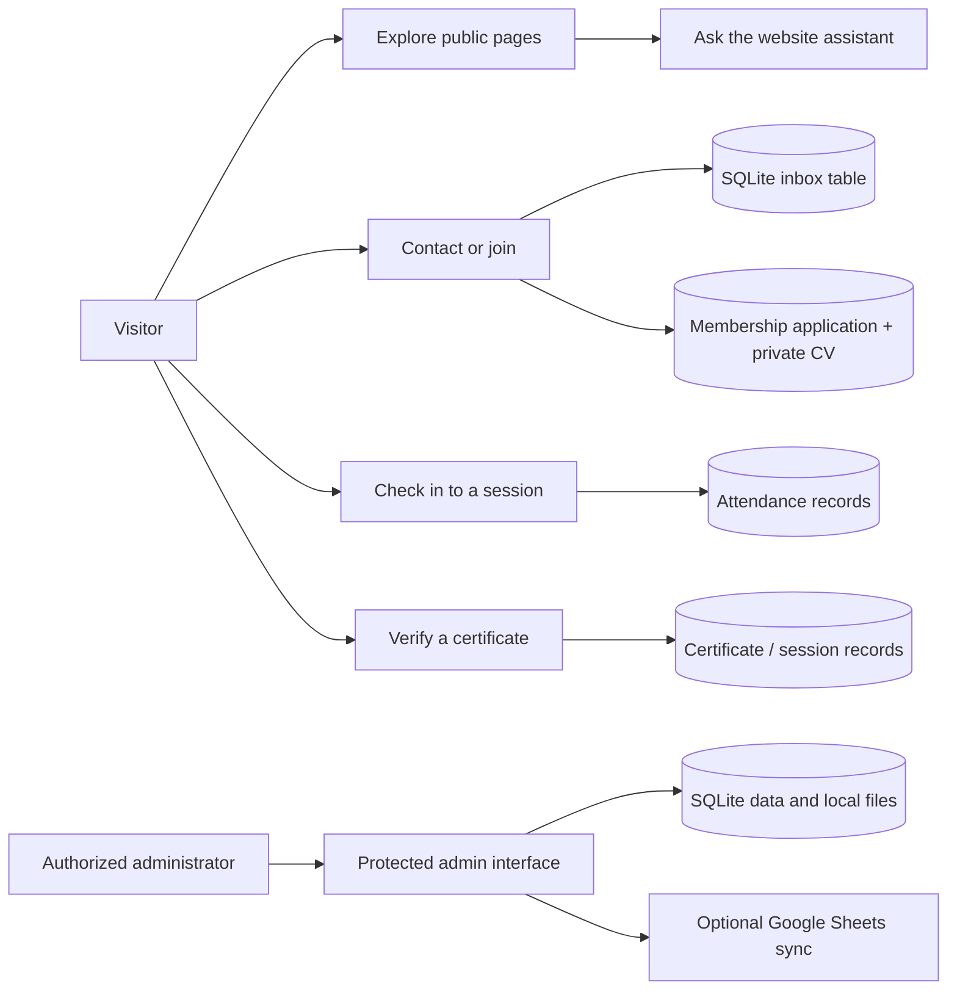
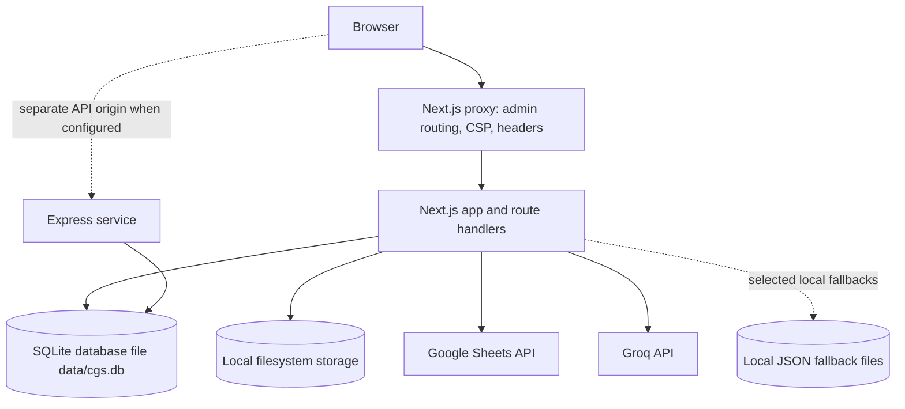

# Cyber Guardian Society Website

> **Project guide · reviewed 12 October 2026**  
> A source-based guide to the website's pages, application behavior, data flows, integrations, security controls, SEO, and operation.

This document describes behavior visible in the repository at the time of review. It is intended to help contributors and operators understand the project; it is not a guarantee that the site is free of defects or a substitute for checking the current source and deployment configuration. Runtime secrets, administrator credentials, private member records, and personal contact details are deliberately not reproduced here.

## Contents

1. [At a glance](#at-a-glance)
2. [Architecture](#architecture)
3. [Technology](#technology)
4. [Website pages](#website-pages)
5. [Admin area](#admin-area)
6. [Design, responsiveness, and accessibility](#design-responsiveness-and-accessibility)
7. [Forms and API routes](#forms-and-api-routes)
8. [Data and storage](#data-and-storage)
9. [External services](#external-services)
10. [Security and privacy](#security-and-privacy)
11. [SEO and Google discovery](#seo-and-google-discovery)
12. [Configuration](#configuration)
13. [Local development and release](#local-development-and-release)
14. [Known setup needs and behavior](#known-setup-needs-and-behavior)
15. [Repository map](#repository-map)
16. [Useful maintenance commands](#useful-maintenance-commands)
17. [Where to make changes](#where-to-make-changes)

---

## At a glance

Cyber Guardian Society (CGS) is a dark-themed public website for a cybersecurity community. It presents the organization, services, products, team, announcements, and events; accepts membership, speaker, contact, and newsletter submissions; supports event attendance and certificate verification; and provides a protected admin interface for managing operational content and records.

| Item | Current implementation |
|---|---|
| Web framework | Next.js 16 App Router (Turbopack) with React 19 and TypeScript |
| Server-side API | Next.js route handlers, plus a separately runnable Express backend |
| Database and authentication | Local SQLite through `sql.js` (`data/cgs.db`), with local filesystem storage and HMAC-signed admin session cookies |
| AI assistant | Server-side Groq API integration, enabled by server configuration |
| Admin sign-in | Email and password checked against the SQLite `admin_users` table (Argon2id), followed by an active-record and permission check |
| Public site domain | **Not selected yet.** Configure it before production so canonical URLs and the sitemap use the real HTTPS origin. |
| Main local command | `npm run dev` |
| Main build command | `npm run build` |

### Main user journeys



## Architecture

The repository contains two server applications:

1. **Next.js website** — renders the pages, provides the browser experience, and serves the primary `/api/*` route handlers used by the current frontend.
2. **Express backend** — a separate service with health, authentication, contact, and quick-join endpoints. It is started alongside Next.js during development by `npm run dev`, listens on `BACKEND_PORT` (default 5001), and reads the same `data/cgs.db` file as the website. The frontend's forms currently use the Next.js routes; the Express service is a distinct API surface and should be deployed only where its endpoints are needed.



The Next.js `proxy.ts` (not `middleware.ts`) participates in request handling: it routes the secret admin base path, applies the Content Security Policy and other response security headers, and answers guessable paths such as `/admin` with a decoy 404. The root layout supplies shared navigation, footer, assistant, toast notifications, and the skip link. Page content and organization details are mostly sourced from `data/site.ts` and `data/legal.ts`.

## Technology

| Area | Packages / approach |
|---|---|
| UI | React 19, Next.js 16 App Router (Turbopack), TypeScript |
| Styling | Tailwind CSS 4, project CSS, CSS custom properties |
| Forms and validation | Zod schemas and server-side route handlers |
| Database | Local SQLite through `sql.js` (`data/cgs.db`), created idempotently by `lib/db/schema.ts` and queried through the compatibility adapter in `lib/db/sqlite-adapter.ts` |
| Authentication | SQLite `admin_users` records, Argon2id password hashing (`hash-wasm`; legacy bcrypt hashes still verify), HMAC-signed admin session cookies |
| Storage | Local filesystem: `public/uploads/content/<kind>/` for public images and `data/private/applications/` for private application files |
| API service | Express 5, Helmet, CORS, rate limiting, Zod |
| AI | Server-side Groq request through `fetch` |
| Google integration | `googleapis` service-account client for Sheets operations |
| Icons and motion | Lucide React and Framer Motion |

Version ranges and exact dependency versions are maintained in `package.json` and the lockfile. Consult those files when installing or upgrading packages.

## Website pages

The following routes are implemented in the Next.js App Router. Exact content, navigation labels, and public contact/social configuration are maintained in the linked source files; personal or private values are not copied into this guide.

| Route | Purpose | Notes |
|---|---|---|
| `/` | Home | Organization introduction, hero, community trust section, sessions, capabilities, and calls to action. Session content is read from the SQLite `online_sessions` table. |
| `/about` | About CGS | Organization background, mission, and related information. |
| `/services` | Services | Describes the society's services and activities. |
| `/products` | Products | Public product/catalog content. |
| `/team` | Team | Team profiles and organization structure. |
| `/testimonials` | Testimonials | Testimonial page; currently no member testimonials are published. |
| `/merch` | Merchandise | Merchandise information/catalog. |
| `/announcements` | Announcements | Public notices and updates. |
| `/contact` | Contact | Contact form and speaker-proposal flow. |
| `/join-cgs` | Join CGS | Membership interest and full application journey. |
| `/join-as-speaker` | Become a speaker | Speaker application/proposal journey. |
| `/attendance` | Session attendance | Participant session check-in. This is not an indexable marketing page. |
| `/verify-certificate` | Certificate verification | Public verification entry point; marked noindex. |
| `/download-certificate` | Certificate download | Certificate-related flow; marked noindex. |
| `/privacy` | Privacy policy | Legal content in `data/legal.ts`. |
| `/terms` | Terms | Legal content in `data/legal.ts`. |
| `/code-of-conduct` | Code of conduct | Community policy in `data/legal.ts`. |

### Shared interface

- **Navigation:** responsive site navbar, desktop mega menus, and a compact mobile navigation pattern. The navbar detects scrolling and uses the site's dark background in its scrolled state.
- **Footer:** organization links and site navigation.
- **Assistant:** floating CGS website assistant, when the server integration is configured.
- **Feedback:** shared toast notifications for form and action status.
- **Accessibility affordance:** skip-to-content link in the root shell.

## Admin area

The admin interface is served through `ADMIN_BASE_PATH`, a configurable, non-public base path. The actual configured value is intentionally not documented here. Guessable public paths, including plain `/admin`, are answered with a decoy 404 by `proxy.ts`. Admin pages are excluded from search indexing.

### Sign-in and access model

- Admin login uses **email and password** verified against the SQLite `admin_users` table (`user_id`, `email`, `password_hash`, `role`, `permission_keys`, `active`). Passwords are hashed with Argon2id in `lib/security/password.ts`; legacy bcrypt hashes still verify. Authentication is entirely local: there is no external auth provider and no 2FA/MFA challenge in the current login flow.
- The matched record must be `active`, and its role and permission keys decide which admin areas the session may use.
- The first admin is seeded by `scripts/seed-admin.ts` (also `npm run seed:admin`) from `ADMIN_EMAIL` and `ADMIN_PASSWORD`. Set those variables to real values before seeding, and **change the password after the first login**.
- Sessions use an HMAC-signed, HTTP-only, secure-in-production, `SameSite=Strict` cookie scoped to the admin base path (`lib/security/session.ts`, signed with `SESSION_SECRET`). The implementation enforces a 30-minute idle timeout and an 8-hour absolute maximum session age.
- Login attempts are rate-limited and lockout state is maintained. Optional IP allowlisting is available through configuration.
- Roles include `super_admin`, `admin`, and `limited_admin`; limited administrators receive selected permission keys and cannot administer other admins.
- A legacy TOTP maintenance module/store remains in the repository but is not required by the current login form. Do not treat its presence as an active login challenge.

### Admin capabilities

The admin interface includes views for:

- Overview/dashboard
- Sessions and time management
- Attendance and registrants
- Membership applications
- Contact inbox
- Activity and audit history
- Speaker applications and speakers
- Announcements, products, merchandise, and free resources
- Administrator management and permission assignment
- Optional Google Sheets connection/synchronization
- Operations exports for attendance and registrant records

Individual operations are permission-checked. The implementation defines permission areas for sessions, applications, inbox, activity, speaker applications, speakers, content types, Google sync, admin management, and audit access. The database and admin UI remain the sources of truth for the exact permission checks.

## Design, responsiveness, and accessibility

The site uses a dark visual theme with near-black surfaces, white text, and blue accent color. Shared CSS tokens and layout rules are defined in `app/globals.css` and related styles. The interface uses responsive Tailwind breakpoints, fluid `clamp()` spacing, a bounded content container with responsive gutters, and mobile-specific navigation/layout behavior.

The project includes a reduced-motion preference, semantic form labels, and a keyboard skip link. Responsive rules are implemented throughout the interface, but no finite set of browser sizes can establish that every possible device and browser combination is flawless. Review key pages at narrow mobile, tablet, laptop, and wide desktop sizes when changing layout or typography.

## Forms and API routes

The current frontend calls Next.js route handlers. Limits and behavior below describe the implementation; production rate limiting depends on configuring a shared/distributed provider for multi-instance hosting.

| Method and route | Function | Validation and handling |
|---|---|---|
| `POST /api/contact` | Contact messages and speaker proposals | Origin checking, bounded request body, schema validation/sanitization, per-IP throttling, duplicate suppression, and masked audit events. Persists to the SQLite `cgs_inbox_messages` table. |
| `POST /api/join` | Short membership-interest form | Validated, size-limited, throttled submission persisted to the same SQLite inbox table. |
| `POST /api/join-application` | Full membership application | Multipart submission with personal, academic/professional, division, skills, and declaration sections; optional PDF CV up to 5 MB; validated and stored with a reference code. CVs and the application JSON are written under `data/private/applications/…` and are reachable only through the signed private-file route. |
| `POST /api/newsletter` | Newsletter subscription | Validates email/source and applies request limits. Current implementation writes subscribers to a local JSON file; no email delivery provider is wired up. |
| `GET, POST /api/certificates/verify` | Certificate lookup & verification | Rate-limited verification returning authentic certificate details. Enforces a high-accuracy filter: only valid, confirmed certificate verifications are recorded to the Supabase database (`admin_audit_log`) and verification logs; empty queries, non-matching IDs, and failed lookups are filtered out and never recorded. |
| `GET /api/admin/operations-export?type=…` | Admin CSV export | Admin-authenticated and permission-controlled export for supported operations data. |
| `GET /api/admin/private-file?path=…&expires=…&sig=…` | Private application file download | HMAC-signed and expiring; rejects path traversal and missing/invalid signatures, and is admin-authorized. |

### Separate Express endpoints

The standalone Express server currently exposes `GET /health`, `POST /auth/login`, `POST /api/contact`, and `POST /api/join`. It configures Helmet, a CORS allowlist, bounded JSON/urlencoded bodies, and a global rate limiter. Its login handler checks the submitted password with Argon2id against the same SQLite `admin_users` table the website uses, but it is separate from the browser's Next.js admin session flow. Do not assume that a successful Express login establishes a website admin session. It runs on `BACKEND_PORT` (default 5001), which must differ from the Next.js `PORT` (default 3000).

## Data and storage

### SQLite data

The database is a single local SQLite file, `data/cgs.db`, opened in-process through `sql.js`. The schema is created idempotently by `lib/db/schema.ts`, so there is no migration step to apply before the site runs. Application tables are prefixed `cgs_` (`admin_users`, `online_sessions`, `applications`, and `admin_audit_log` keep their unprefixed names). The data layer is split as:

- `lib/db/client.ts` — connection, wasm loading, atomic saves back to `data/cgs.db`, and mtime-based freshness checks so writes made by another process are picked up before the next statement.
- `lib/db/schema.ts` — idempotent schema creation for every table.
- `lib/db/query.ts` — shared query helpers.
- `lib/db/sqlite-adapter.ts` — a Supabase-compatible query API (`from().select/insert/update/delete/upsert/eq/ilike/in/order/limit/single/maybeSingle`, plus `auth`) so existing call sites keep working.
- `lib/supabase/server.ts`, `lib/supabase/service.ts`, `lib/supabase/audit.ts`, and `lib/supabase/sessions.ts` — compatibility modules that keep their original import paths but are SQLite-backed (`createSupabaseServerClient`, `createSupabaseServiceClient`, `logAudit` writing to `admin_audit_log`, and `readPublicOnlineSessions`).

Tables currently cover:

| Data area | Tables / records |
|---|---|
| Admin identity and permissions | `admin_users` |
| Sessions and speakers | `online_sessions`, `cgs_speakers`, `cgs_session_speakers` |
| Registrations and attendance | `cgs_registrants`, `cgs_session_registrations`, `cgs_attendance_records` |
| Membership applications | `applications` |
| Admin audit | `admin_audit_log` |
| Google sync | `cgs_google_sheet_connections`, `cgs_google_sync_runs` |
| Portal configuration | `cgs_portal_settings` |
| Public forms/inbox | `cgs_inbox_messages` |
| Managed public content | `cgs_managed_content` |

SQLite has no row-level security and there is no SQL policy layer. Authorization is enforced in the application instead: every admin page, server action, and export checks the signed admin session cookie and the caller's permission keys before it runs a query, and the database file is only opened from server-side code. Review those checks before exposing a new table or query — a table's existence alone does not mean it is safe to expose.

The `supabase/` directory in the repository is legacy reference material only. Nothing at runtime reads it, and its migrations are not part of the setup or deployment path.

### Local file storage

Storage is the local filesystem, implemented in `lib/supabase-storage.ts`:

- Public content images (announcement, product, merchandise, and resource artwork) are written to `public/uploads/content/<kind>/` and served statically. Uploads are constrained by image type/size checks and server-generated file names.
- Private application files (CVs and application JSON) are written under `data/private/applications/…` and are never served statically. They are reachable only through the HMAC-signed route `GET /api/admin/private-file?path=&expires=&sig=`, which rejects path traversal, expiry, and invalid signatures.

Because storage is instance-local, uploads must live on a persistent volume (or shared storage) when the site runs somewhere that does not keep its own filesystem between deploys.

### Local JSON fallback and runtime files

Alongside the SQLite database, the codebase uses local JSON files for selected fallback or operational state, including newsletter subscribers, login lockout state, and legacy 2FA state. These files can contain operational or personal data and must not be copied into documentation or committed.

Local filesystem storage may be ephemeral or instance-local on serverless and multi-instance platforms. The newsletter subscriber store is explicitly local-only today. Use durable shared storage or a mailing-list provider before relying on those flows in production.

## External services

| Service | Purpose | Configuration / operational note |
|---|---|---|
| Groq | Generates assistant responses | Uses `GROQ_API_KEY` server-side. The assistant route should fail closed as unavailable when it is absent. |
| Google Sheets | Optional admin sync | Uses a Google service account and configured spreadsheet connection. Private key and service-account credentials belong only in server secrets. |
| Optional shared rate-limit store | Cross-instance public request throttling | The limiter can use an Upstash-compatible Redis configuration when provided; its default in-memory behavior is local to a process. |

The database (`data/cgs.db`) and file storage are local to the deployment rather than external services, so there is no hosted database provider to configure; see [Data and storage](#data-and-storage) for the constraints that follow from that.

## Security and privacy

Security behavior is implemented across `proxy.ts`, `next.config.js`, `lib/security/`, `lib/db/`, API route handlers and admin server actions, and the Express middleware. Important controls present in source include:

- Per-request Content Security Policy nonce handling and browser security headers.
- Production HSTS, frame restrictions, content-type protection, referrer policy, permissions policy, and cross-origin policies.
- A configurable hidden admin base path, rewrite validation, admin no-cache/noindex behavior, optional IP allowlisting, and decoy paths.
- Argon2id password verification against the SQLite `admin_users` table plus active-record checks; HMAC-signed, scoped admin session cookies; role/permission checks; login rate limits and lockouts.
- Origin checks, Zod validation, payload-size limits, sanitization, throttling, duplicate suppression, and audit events for public forms.
- Private upload storage on the local filesystem, file size/type constraints, server-generated upload paths, and short-lived HMAC-signed private-file URLs.
- Masked email/IP values in relevant public form audit events.
- Application-layer authorization in front of a server-only SQLite file: permission checks live in the route handlers, server actions, and admin pages that query it.
- The assistant's retrieved page text is treated as untrusted reference material. The assistant has no privileged tools/actions; it has bounded input/context and escalates requests involving a human handoff, sensitive incidents/disclosures, or secret patterns.

These controls reduce specific risks but do not prove the entire website is bug-free or secure. Reassess the complete data flow when adding routes, changing admin permissions, changing the SQLite schema or query helpers, adding uploads, or connecting new third-party services. Keep dependency versions and deployment headers current.

### Sensitive information handling

- Never add real `.env` values, admin credentials, secret admin path, private keys, database file contents, session secrets, or customer/member records to this document or source control.
- Values prefixed with `NEXT_PUBLIC_` are delivered to browsers and must be treated as public. Never put a private key or privileged token in one.
- The SQLite database `data/cgs.db` and the `data/private/` tree hold live admin, application, and attendance records. Treat them as sensitive operational data: do not commit them, copy them into docs, or expose them through static hosting.
- `SESSION_SECRET`, `GOOGLE_PRIVATE_KEY`, `GROQ_API_KEY`, `TOTP_ENCRYPTION_KEY`, `ADMIN_EMAIL`, and `ADMIN_PASSWORD` are server-only values.
- Do not place identity-card numbers, home addresses, CVs, or other unnecessary personal details in logs, screenshots, test fixtures, or docs.

## SEO and Google discovery

SEO support is implemented in `lib/seo.ts`, `app/sitemap.ts`, `app/robots.ts`, and page-level metadata layouts. Public metadata includes page titles/descriptions, Open Graph and Twitter cards, canonical URL support, and Organization/WebSite structured data. The sitemap lists indexable public routes; robots directives block admin and API paths. Admin, attendance, and certificate flows are noindex; testimonials are also excluded while no testimonials are published.

### Domain setup is still required

The site has not been deployed and the canonical HTTPS domain has not been selected. The application can read `NEXT_PUBLIC_SITE_URL` or `SITE_URL`, and can fall back to a Vercel production URL when available. Until a real production URL is configured, canonical metadata may be omitted and the sitemap may be empty rather than publishing localhost URLs. A local build has also warned that `metadataBase` cannot be set to the real production origin without that configuration.

Before launch:

1. Choose and configure the production HTTPS domain in both site URL settings.
2. Verify the canonical origin, page metadata, `robots.txt`, sitemap, Open Graph image references, and structured data on the deployed site.
3. Add and verify the domain in Google Search Console, then submit the sitemap there.
4. Publish useful, original page content and acquire legitimate links/citations. Technical SEO improves crawlability but cannot guarantee rankings or immediate visibility.
5. Recheck metadata and sitemap after changing public routes or the domain.

## Configuration

`.env.example` documents variable names and purposes. It contains placeholders only. Keep the real `.env.local` and production values private.

| Variable | Use | Visibility |
|---|---|---|
| `NEXT_PUBLIC_APP_NAME` | Public application/brand label | Browser-visible |
| `NEXT_PUBLIC_APP_TAGLINE` | Public tagline | Browser-visible |
| `NEXT_PUBLIC_API_BASE_URL` | Optional separate API origin | Browser-visible; origin is not a secret |
| `NEXT_PUBLIC_SITE_URL` | Public canonical site origin for metadata/SEO | Browser-visible |
| `SITE_URL` | Server-side canonical site origin | Server-only |
| `CORS_ORIGINS` | Allowed origins for API requests | Server configuration |
| `ADMIN_BASE_PATH` | Configurable admin routing path | Sensitive operational configuration; do not publish its value |
| `SESSION_SECRET` | Signs admin sessions | Secret; use a strong random value (at least 32 characters in production) |
| `ADMIN_IP_ALLOWLIST` | Optional source IP allowlist | Server configuration; follow trusted proxy setup |
| `ADMIN_EMAIL` | Email for the first admin account seeded by `scripts/seed-admin.ts` | Server configuration; keep real values private |
| `ADMIN_PASSWORD` | Password for the first admin account seeded by `scripts/seed-admin.ts` | Secret; change it after the first login |
| `TOTP_ENCRYPTION_KEY` | Encrypts stored TOTP secrets for the legacy 2FA maintenance module | Secret; server-only |
| `GOOGLE_SERVICE_ACCOUNT_EMAIL` | Google service identity | Server configuration |
| `GOOGLE_PRIVATE_KEY` | Google service-account private key | Secret; server-only |
| `GROQ_API_KEY` | Assistant provider key | Secret; server-only |
| `PORT` | Next.js server port | Server configuration |
| `BACKEND_PORT` | Express backend port; must differ from `PORT` | Server configuration |

The SQLite database path is fixed at `data/cgs.db`; there is no database connection-string variable to configure.

The optional distributed rate-limit integration can use Upstash-compatible credentials in the runtime configuration even though they are not listed in `.env.example`; inspect `lib/security/public-rate-limiter.ts` before enabling it. Do not copy live credentials into the example file.

## Local development and release

### Prerequisites

- Node.js and npm versions compatible with the package lockfile and current Next.js dependencies.
- Write access to `data/` inside the project directory: the SQLite database `data/cgs.db` and the private application files are created there, and the schema creates itself on first use.
- Optional Groq and Google service-account credentials for those integrations.

### Start locally

1. Install dependencies with `npm install`.
2. Copy `.env.example` to a local environment file and fill only the values needed for the work, including `ADMIN_EMAIL` and `ADMIN_PASSWORD` if you need an admin account.
3. Seed the first administrator with `npm run seed:admin`, and change that password after the first login.
4. Start the frontend and Express development service with `npm run dev` (or `npm run dev:frontend` for the Next.js server alone).
5. Open the local Next.js origin shown in the terminal. Check the configured backend port if testing the standalone Express API; `PORT` (default 3000) and `BACKEND_PORT` (default 5001) must differ.

### Build and type validation

| Command | Effect |
|---|---|
| `npm run dev` | Starts Next.js and Express together for development. |
| `npm run dev:frontend` | Starts only the Next.js development server. |
| `npm run dev:backend` | Starts only the Express service with file watching (`tsx watch`). |
| `npm run build` | Creates the Next.js production build. |
| `npm run build:backend` | Compiles the Express backend with `tsc -p backend/tsconfig.json`. |
| `npm start` | Starts the built Next.js server. This script does not start the separate Express service. |
| `npm run typecheck` | Type-checks the frontend and backend TypeScript projects. |
| `npm run test:adapter` | Runs the SQLite adapter assertions (28 checks). |
| `npm run test:admin` | Exercises the admin server-action write path. |
| `npm run smoke` | Runs the end-to-end smoke test; it needs a running server. |
| `npm run verify` (alias `npm test`) | Runs `typecheck` followed by `test:adapter`. |
| `npm run seed:admin` | Creates the first administrator in `admin_users` from `ADMIN_EMAIL`/`ADMIN_PASSWORD`. |
| `npm run lint` | Currently aliases to `typecheck`; it is not a separate ESLint run. |

The repository also includes security-oriented scripts such as `scripts/test-security.ts` and `scripts/test-public-forms-security.ts`, which are run directly with `tsx`. Review their current implementation and environment requirements before running them. No claim of complete test coverage is made here.

### Production checklist

- Configure the real HTTPS domain and canonical site URL.
- Configure all required environment values in the host's secret manager, including a strong `SESSION_SECRET` and a non-default `ADMIN_BASE_PATH`.
- Run `npm run seed:admin` once with real `ADMIN_EMAIL`/`ADMIN_PASSWORD`, then change the password after the first login; do not add shared default credentials.
- Run a **single Next.js process per `data/cgs.db` file**, and run the Express backend on the same machine if it must share that file. Cross-process staleness is handled by mtime-based reloads, but concurrent write bursts against the same file should be avoided.
- Keep `data/cgs.db`, `data/private/`, and `public/uploads/` on persistent storage that survives deploys, and back them up; there is no hosted database to fall back on.
- Configure a distributed rate-limit provider if the app will run across multiple instances.
- Deploy Express separately if any production consumer depends on its API; the Next.js `start` command alone does not launch it.
- Check sitemap, robots, metadata, form submissions, login, uploads, attendance, and certificate verification against the deployed environment.
- Configure backups, monitoring, and recovery for the database file, the upload directories, and any external services.

## Known setup needs and behavior

These are repository/configuration facts to account for; they are not claims that all production behavior has been exercised:

1. **No production domain yet.** Canonical URLs and Google Search Console setup need a real domain.
2. **Newsletter is local-only.** Subscription data is written to a local JSON file, and no mailing provider or confirmation email service is configured.
3. **Two API servers exist.** The Next.js route handlers are the current frontend API; Express is separately started and requires its own production deployment if needed.
4. **Local JSON persistence is not distributed.** It may not survive redeploys or be shared across instances.
5. **The database is a single-process SQLite file.** `sql.js` keeps the database in memory and rewrites `data/cgs.db` after writes. Run one Next.js process per database file, and run the Express backend on the same machine if it shares that file. Mtime-based reloads handle ordinary cross-process freshness, but concurrent write bursts against the same file should be avoided.
6. **Some content is unpublished/configuration-dependent.** Testimonials are empty; sessions, products, announcements, and other managed content depend on current database/content configuration.
7. **Admin access depends on provisioning.** The first admin must be seeded with `scripts/seed-admin.ts` from `ADMIN_EMAIL`/`ADMIN_PASSWORD`, must stay `active` with the relevant role/permissions, and its password must be changed after the first login.
8. **Build metadata warning without a domain.** A local production build may warn that the real `metadataBase` is unavailable; configure the production site URL to resolve this correctly.
9. **No universal quality guarantee.** Device coverage, external integrations, SEO outcomes, and security all require ongoing validation in the target deployment.

## Repository map

```text
app/                    Next.js pages, layouts, route handlers, and global styles
  api/                  Public and admin Next.js API endpoints
  admin/                Admin pages and route-specific metadata
  ...                   Public pages and nested layouts
backend/                Separate Express API server, middleware, and routes
components/             Shared page, navigation, form, and assistant components
data/                   Source-configured site and legal content
  cgs.db                Local SQLite database (runtime data; never commit real records)
  private/              Private application files, readable only through the signed route
lib/                    Data layer, schemas, SEO, integrations, and security helpers
  db/                   sql.js client, idempotent schema, query helpers, SQLite adapter
  supabase/             SQLite-backed compatibility modules that keep the old import paths
public/                 Static browser assets, icons, and images
  uploads/content/      Public content images written by the admin interface
scripts/                Admin seeding/maintenance and validation scripts
supabase/               Legacy migrations and setup notes; nothing at runtime reads this
types/                  Shared TypeScript definitions
proxy.ts                Request proxy for admin routing, CSP, and security headers
next.config.js          Next.js security headers and build configuration
package.json            Dependencies and npm scripts
.env.example            Environment-variable names with placeholder values
```

Local `data/*.json` runtime stores and the `data/cgs.db` database may exist in addition to source-controlled data; never mistake those runtime files for safe documentation fixtures.

## Useful maintenance commands

The repository includes utility scripts for generating the secret admin base path and maintaining local admin lockout/legacy MFA state. These scripts can change security-sensitive state. Read the specific script first and run it only against the intended local environment. Do not paste generated paths, recovery details, credentials, or secret output into issues or documentation.

For an admin account, run `npm run seed:admin` (`scripts/seed-admin.ts`) with `ADMIN_EMAIL` and `ADMIN_PASSWORD` set, then change the password after the first login. `supabase/ADMIN_SETUP.md` and the SQL under `supabase/` are legacy reference material only and are not part of the current setup path. Never rely on example/test data as production credentials.

## Where to make changes

| Change | Start here |
|---|---|
| Add/update a public page | `app/` and shared components in `components/` |
| Update brand, navigation, public content, or contact configuration | `data/site.ts` |
| Update privacy, terms, or conduct policies | `data/legal.ts` |
| Change SEO metadata, sitemap, or crawler rules | `lib/seo.ts`, `app/sitemap.ts`, `app/robots.ts`, and page metadata layouts |
| Change a public form/API contract | Relevant `app/api/*/route.ts` and `lib/schemas/public-forms.ts` |
| Change admin authorization/session behavior | `app/admin/` pages and server actions, `proxy.ts`, and `lib/security/` (`session.ts` and the permission checks) |
| Change the data layer or a query helper | `lib/db/client.ts`, `lib/db/query.ts`, `lib/db/sqlite-adapter.ts`, and the compatibility modules in `lib/supabase/` |
| Change the database schema | `lib/db/schema.ts` (idempotent SQLite schema; no migration files are required) |
| Change file upload behavior | `lib/supabase-storage.ts`, the relevant application API route, and `app/api/admin/private-file/route.ts` |
| Change the website assistant | `app/api/assistant/route.ts` and `lib/cgs-website-knowledge.ts` |
| Change Google Sheets sync | `lib/google-sheets.ts` and admin sync routes/components |
| Change visual tokens or global responsive rules | `app/globals.css` and shared layout/components |
| Change Express endpoints | `backend/` and its server/middleware configuration |
| Change environment configuration | `.env.example` and the readers in `lib/admin-config.ts` |

---

### Document maintenance

Update this file when routes, APIs, integrations, storage behavior, admin permissions, environment variables, or deployment steps change. Verify descriptions against source before treating them as current. Keep credentials, secret paths, and personal data out of the document.
